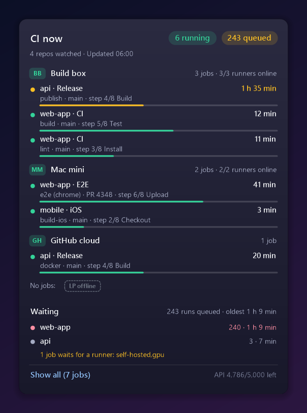

# CI Widget

A small pill on the Windows taskbar that shows every GitHub Actions job running right now across your repos, grouped by
the machine it runs on, plus how many runs wait in the queue. Hover it for the details; click a job to open it on GitHub.




- **1 block per machine**: how many jobs it runs now. Self-hosted runners are grouped by name patterns you choose; GitHub's own
  runners show as "GitHub cloud".
- **Queue**: runs waiting for a runner, coloured by the oldest wait (amber after 10 min, red after 30 min).
- **Hover card**: every busy machine with its jobs, the current step and how long each has run, then the queue per repo.
- **Show all**: every job in a list with search, machine and status filters, grouping and sorting.
- Light and dark taskbars, any display scale, no admin rights. It reads GitHub with the token `gh` already holds, and only
  calls api.github.com.

## Install (Windows 10 or 11)

1. Install the GitHub CLI and sign in once: `gh auth login`.
2. Download this repo as a zip and unpack it.
3. Double-click `Install CI Widget (Windows).cmd`.

It compiles the widget with the C# compiler built into Windows, runs its self-test, adds it to your Startup folder and starts
it. To remove it, run `Uninstall CI Widget (Windows).cmd`: your config stays.

## Choose what it watches

With no config the widget watches every repo `gh`'s active account can reach that was pushed in the last 30 days. To choose, right-click the
pill and pick **Edit config**: it opens `%USERPROFILE%\.ci-widget\config.json` (created from an example the first
time).

```json
{
  "accounts": [
    { "name": "work", "gh_user": "my-login", "orgs": ["acme"], "repos": ["my-login/side-project"], "runner_orgs": ["acme"] }
  ],
  "machines": [
    { "name": "Build box", "code": "BB", "runners": ["build-box-*"] },
    { "name": "Mac mini", "code": "MM", "runners": ["mac-mini-*"] }
  ],
  "exclude_repos": ["acme/old-thing"],
  "poll_seconds": 30,
  "max_calls_per_hour": 900
}
```

| Key | What it does |
| --- | --- |
| `accounts[].gh_user` | the `gh` account whose token to use; empty = the active one |
| `accounts[].token_env` | or an environment variable that holds a token |
| `accounts[].orgs`, `users`, `repos` | what to watch; archived repos are skipped |
| `accounts[].runner_orgs`, `runner_repos` | where to list runners, so idle and offline machines show too (needs `admin:org` or repo admin) |
| `machines[]` | a name, a 2–3 letter code and runner name patterns (`*` and `?`) |
| `exclude_repos` | repos to skip |
| `poll_seconds` | how often to look, 10–600 (default 30) |
| `max_calls_per_hour` | API budget per account (default 900 of GitHub's 5,000) |
| `queue_warn_minutes`, `queue_crit_minutes` | when the queue turns amber and red (default 10 and 30) |

The widget saves the file's changes on its own: no restart needed. It keeps well under GitHub's rate limit: unchanged
answers are free (ETag), quiet repos are read every 5 min, and it slows down by itself when the budget runs low.

## Develop and test

```sh
sh tools/verify.sh windows-core   # build and self-test, ~15 s
sh tools/verify.sh windows        # plus the install and uninstall tests in scratch folders
sh tools/verify.sh privacy        # no tokens or private names in tracked files
```

`windows/bin/CIWidget.exe --render <folder>` writes PNG renders of every state; `--probe <file.json>` runs 1 live round with
your config and writes what it found. See [AGENTS.md](AGENTS.md) for the layout.

## License

[MIT](LICENSE)

See [CHANGELOG.md](CHANGELOG.md) for what changed in each release.
